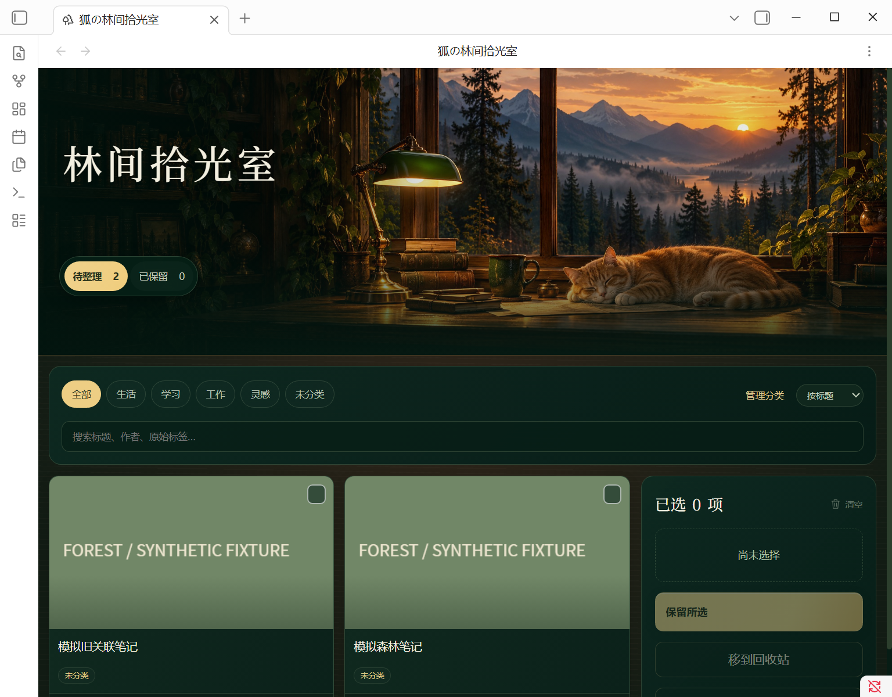

# 狐の林间拾光室

面向 Obsidian 的本地小红书收藏整理与展示插件，插件 ID 为 `fox-shiguang`。抓取小红书收藏和下载媒体需要配套使用基于 [RedLink（上游作者 boaleiyt）](https://github.com/boaleiyt/redlink) 改编的拾光室适配插件。RedLink 通过 Vault 内的 Markdown 和媒体文件与拾光室协作，已落盘的本地收藏可独立浏览。

当前版本为 `0.2.0-beta.2` 预发布：提取原版森林界面，连接独立插件的数据、主题和阅读管理。建议先在隔离 Vault 中安装体验。



## 安装

使用桌面版 Obsidian 1.6.6 或更新版本。关闭隔离 Vault 的受限模式，将安装 ZIP 中的 `fox-shiguang` 文件夹放入该 Vault 的 `.obsidian/plugins/`，再从第三方插件列表启用。首次启动会打开设置向导。也可从命令面板运行「狐の林间拾光室：打开拾光室」，从 Obsidian 插件设置修改路径和分类。

新用户可在向导里一键创建 `小红书raw/RedNote/{Inbox,Bookmarks,Cache,Covers}`。已有目录可直接选用。更换根目录后请核对 RedLink 适配版的输出位置。两个插件各自管理路径。

停用插件会关闭拾光室视图。卸载前如需留存设置，请先备份本插件的 `data.json`。Obsidian 卸载会移除插件安装目录。收藏文件夹及独立于该目录的媒体仍由 Vault 管理。

## 构建

需要 Node.js 20 或更新版本，以及 npm。在源码目录运行：

```sh
npm ci
npm test
npm run build
```

产物是 `dist/fox-shiguang/` 内的 `manifest.json`、`main.js`、`styles.css` 和 `LICENSE`。从这四个文件重建 ZIP，并保留顶层 `fox-shiguang/` 文件夹。开发安装和打包须在独立 Vault 及项目目录进行。

## 当前能力

- 独立 Obsidian 视图、打开命令和原生设置页。
- 可稍后完成或从设置重新运行的首次启动向导。向导完成前的临时选择不会写盘。
- 收藏根目录、标准子目录、非标准路径、文件夹重命名跟随、自动刷新和手动扫描。
- 通用主题模板和本地分类的增删改、顺序、图标、颜色。操作只影响分类设置。
- 原版森林布局、真实本地封面卡片、搜索、主题筛选、批量选择和右侧已选面板。
- 大预览阅读器、本地图片/音视频、Inbox 与 Bookmarks 切换、多主题编辑和旧主题 JSON 只读预览。
- 用户确认后将 Inbox 笔记保留到 Bookmarks，或把选中笔记移入 Obsidian 回收站。目标同名文件不会覆盖，媒体文件不会随清理删除。
- 默认关闭的 AI 偏好和服务商、模型名称配置。当前版本没有模型调用或凭证输入。

## 数据和后续工作

Inbox 用于待整理收藏，Bookmarks 用于已保留收藏。文章关联保存在 Markdown 的 `shiguangTopics` 中，改名或移动不改变原帖身份。目录与主题名称由 Obsidian 原生设置维护。首页不另设设置或工作台入口。

AI 默认关闭，关闭时隐藏相关入口及面板。开启只显示尚未连接状态，本版本不调用模型、不提供模拟推荐。正式知识入库、历史草稿迁移及网络获取媒体不属于本轮能力。

原角色图的再分发权尚未核实，公开包保留森林背景与文字品牌，不包含该角色图。阅读器对过大的媒体或不支持的编码给出提示，可打开原笔记查看。

[English](README.en.md) · [更新日志](CHANGELOG.md) · [测试报告](docs/test-report-beta2.md) · [提取清单](docs/ui-extraction.md) · [开源调研](docs/open-source-comparison.md) · [数据与配置结构](docs/data-and-config.md) · [旧主题兼容预览](docs/legacy-import.md) · [素材说明](assets/README.md) · [许可证](LICENSE)
